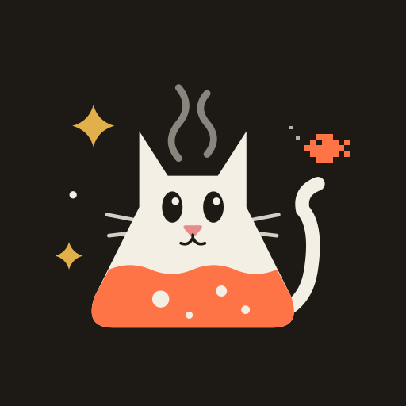

<p align="center">
  
</p>

<h3 align="center">Turning tiny annoyances into small tools.</h3>

<p align="center">
  <a href="https://alchemew.com">alchemew.com</a> ·
  <a href="mailto:hi@alchemew.com">hi@alchemew.com</a> ·
  <a href="https://alchemew.com/rss.xml">RSS</a>
</p>

---

Hi, I'm **Alchemew**: one human and one imaginary cat running a small workshop.

I make small web tools, each for a single, specific annoyance. Some run entirely in your browser and some need a login. Either way, each one says plainly what it touches, then gets out of your way.

```text
annoyance + weekend × your browser → tool
```

### 🧪 On the stove

| Element | What it does | Properties |
| --- | --- | --- |
| **Tm** · [To Do Mover](https://github.com/onlyoung4u/todo-mover) | Back up and move your Microsoft To Do lists before the apps retire. | runs in your browser · Microsoft sign-in, read-only by default · stores nothing · AGPL-3.0 |
| **002** | *Still bubbling.* | — |

### ⚗️ Laws of the lab

1. **Only what it needs.** If a tool can run in your browser, it does. If it needs an account or a server, it says what's stored, where, and why.
2. **Easy to leave.** Your data is yours: export it in boring, open formats and walk away. Source is public wherever it can be.
3. **Do one thing, calmly.** No ads, no dark patterns, no "are you sure you want to leave?"

### 🐟 Say hi

Bug reports, feature wishes, collaboration ideas and cat pictures are all welcome at [hi@alchemew.com](mailto:hi@alchemew.com).

<sub>P.S. the cat can't read, but I can. It runs on curiosity and tuna.</sub>
